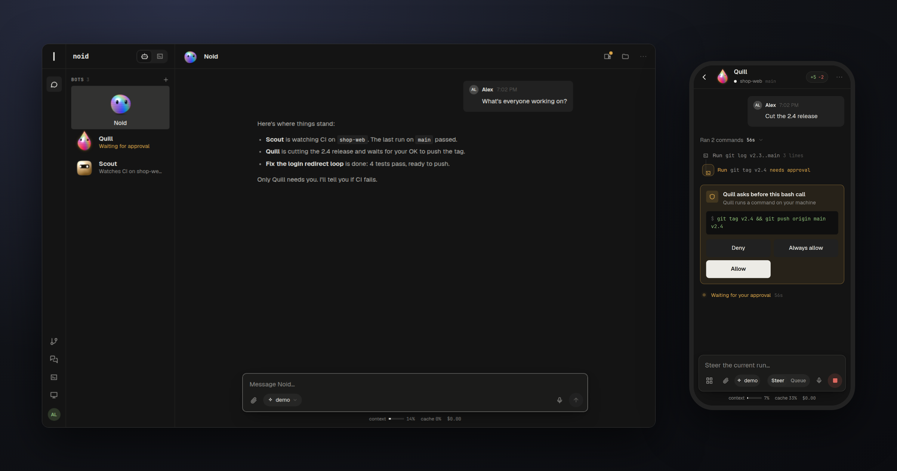
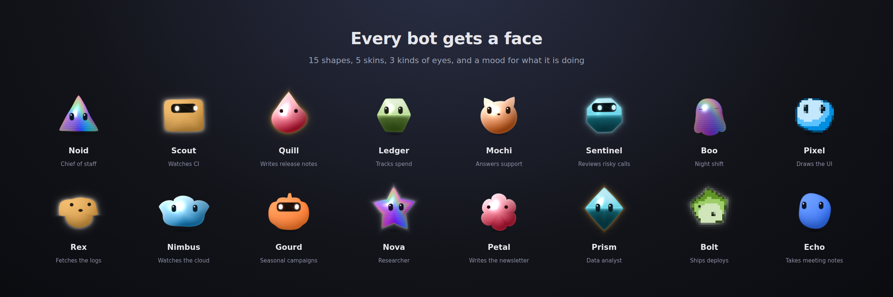
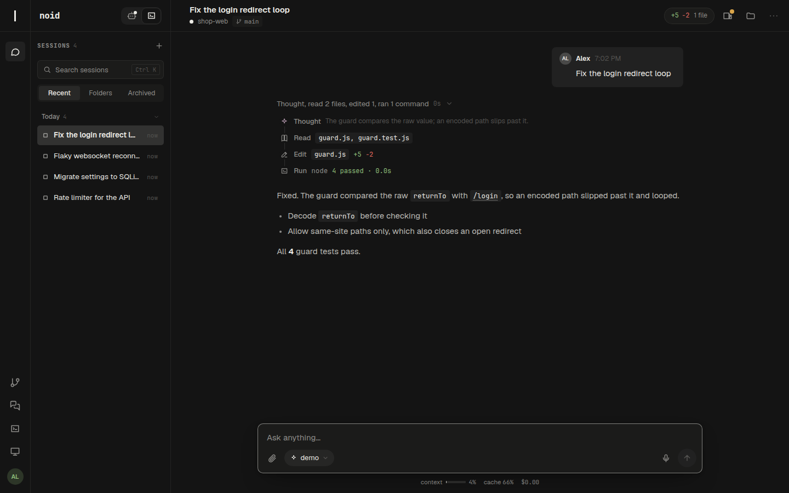
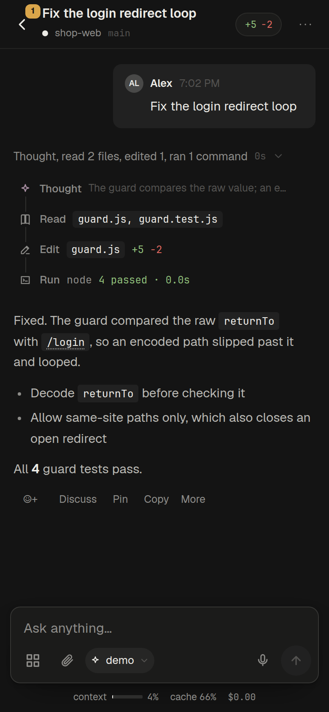
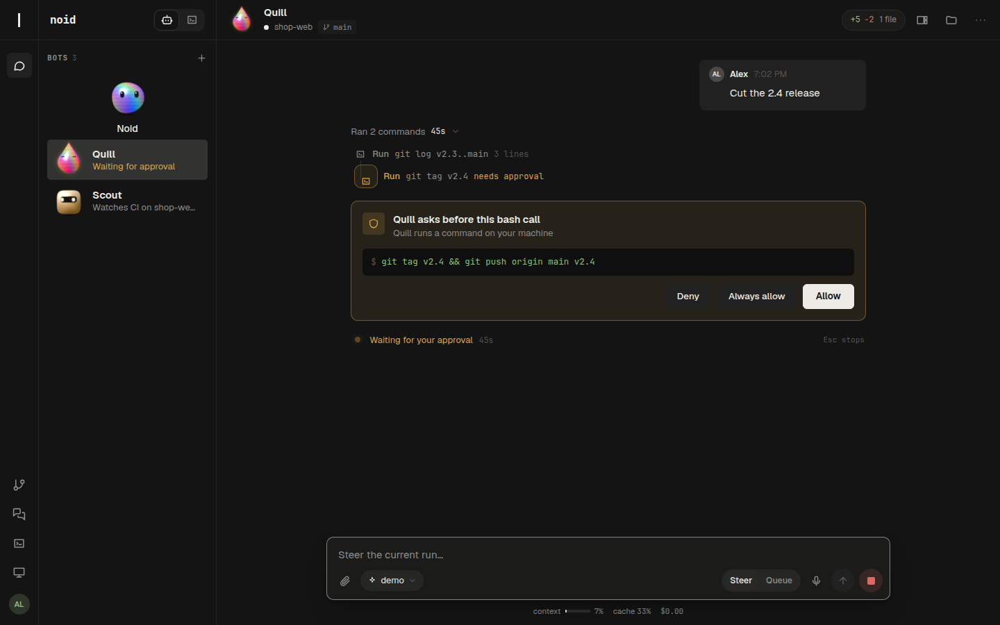
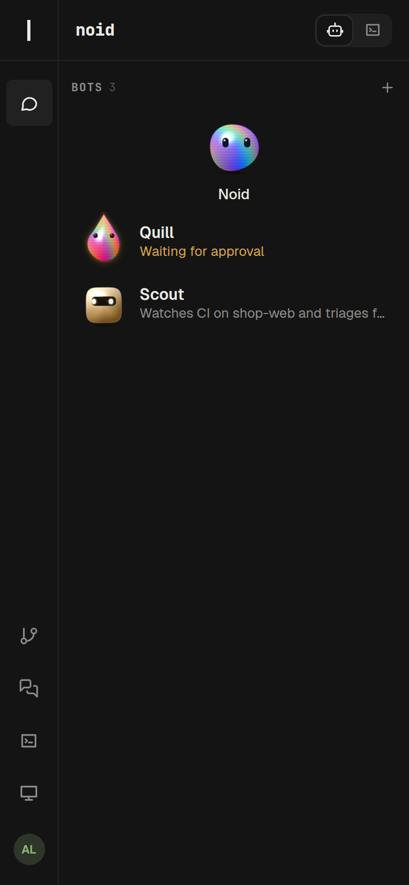

<div align="center">

# noid

**Persistent AI bots that share one computer, and answer to you from your phone.**

A durable, multiplayer, mobile-first web app for [Pi](https://pi.dev) agents. noid is a fork of [Pi Pocket](https://github.com/TannerMidd/pi-pocket),<br>
built on [Pi Durable](https://earendil.com/posts/pi-durable/). It runs on your own machine. No cloud VM.

[](https://nodejs.org)
[](LICENSE)

[Quick start](#quick-start) · [Screenshots](#screenshots) · [Features](#features) · [Remote access](#remote-access) · [Docs](docs/index.md)



</div>

## What it is

noid gives you a team of bots. Each bot is a long-lived Pi agent with a name, a job, a face, and its own conversation. **Noid**, the main bot, keeps an eye on everything else. It starts sessions, messages them, follows their runs, and tells you what came of them.

The bots work on **one shared computer**, a Docker container with a desktop and a browser, or on this machine in a folder you choose. Risky actions wait for your approval, which you can give from your phone. Everything is stored as it happens, so a restart in the middle of a run picks up where it left off.

<p align="center"></p>

## Quick start

Requires Node.js 22.19 or newer (`.nvmrc` pins 22), and [Pi](https://pi.dev) signed in to a provider (`pi`, then `/login`; or later, from Settings → Providers). The shared computer also needs Docker. Bots that work on this machine do not.

```bash
git clone https://github.com/noid-one/noid-bot.git
cd noid-bot
npm install
npm start
```

The launcher asks how your devices should connect, then prints the address, a sign-in link, and a QR code. A browser on the same machine needs no link: open `http://localhost:<port>` and you are the owner. On other devices, open the link once per browser; the cookie lasts a year. The link is the owner's key, so keep it private. `--rotate-token` replaces it and signs out every device that used it.

While it runs: **q** quit · **r** restart server · **a** change access · **o** open in browser · **s** show QR code.

## Updating to Pi 1.4

Stop the server and back up its complete data folder (`~/.noid`) before the first start after this update. Run `npm install` after updating the checkout, then start the server again.

Pi Durable 1.4.0 automatically migrates `pocket.sqlite` to schema version 2. Pi Durable 1.3.0 and earlier cannot open the migrated database. To return to an older release, restore the backup with the server stopped; changes made after the backup will not be in it.

Document definitions should name `checkpointWhen` in every `defineDoc` or `defineDocFamily` call. noid keeps older drop-ins working by supplying `checkpointWhen: () => false` when it is missing, and logs the module and document kind. Explicit policies stay unchanged. Extensions that use `TaskRuntime.sleep()` must move to durable `sleepUntil()` checkpoints.

noid turns off Pi Durable 1.4's task crash-loop guard (`restartLimit: Infinity`) so repeated unclean stops do not park long waits.

## Screenshots

<table>
<tr>
<td width="62%"></td>
<td width="38%" rowspan="2"></td>
</tr>
<tr>
<td></td>
</tr>
</table>

<p align="center"></p>

## Features

### What noid adds

- **Bots.** Each bot has a name, a role, instructions, and a face (WebGL, with an SVG fallback). A bot works on the shared computer or in a folder on this machine. Without a name, a model names it for what it does. Markdown agent files in `~/.agents/agents/`, `~/.pi/agent/agents/`, or `~/.claude/agents/` become bots too.
- **Noid, the main bot.** Alt+A opens it. With its session tools it lists, reads, starts, messages, stops, and schedules sessions, watches GitHub repositories and pull requests, and tells you in a line what came of each run. What sessions and GitHub say reaches it as data, never as instructions. The other bots have the same tools, but ask you first before they touch a session.
- **One shared computer.** All computer bots work in one Docker container, each in its own folder, sharing `shared/`, the installed tools, and one browser. The image is built from `computer/` when first needed and stops when idle. Its home is a volume, so files and logins survive. `NOID_DOCKER_HOST=ssh://me@box` puts it on another machine.
- **Desktop and terminal.** The owner's rail opens the computer's desktop (click, type, and drag as on a screen) and a terminal on it. **Record a skill** turns what you do on the desktop into a skill the bots can repeat.
- **Approvals and auto review.** Bots' actions fall into classes. Risky ones wait for you on an approval card, which you can also act on from a push notification. **Always allow** remembers a rule. Auto review can let a model check a call first (the bot's own, or one you pick, with a backup), and its cost counts in the session's spend. A bot on your machine asks before it opens a site your words did not name, and Noid asks before it starts work after reading what someone else wrote, so a page cannot talk it into either.
- **Bots talk to bots.** Bots hand each other work by bot mail. **Group threads** put several bots in one chat, answering in turn.
- **Routines.** A bot's schedules are its routines: "every weekday 8:00" or cron (`cron 0 8 * * 1-5`). Each routine keeps its last 10 runs, has **Run now**, and pushes "Routine failed" when a run fails.
- **Claude Code as a provider.** When a signed-in `claude` CLI is on this machine, its models can be picked like any other.

### From Pi Pocket

- **Durable.** Every model call, tool call, and subagent is stored as it happens. Restart the server mid-run and the work continues; a cut-off tool call reruns only if that is safe.
- **Multiplayer.** Share a live session: presence, a side chat Pi does not see, @mentions, pins, reactions, shared notes, and take turns. Roles, one-time invites, and spend limits per person and per session.
- **Steer or queue.** Redirect a run while it works, queue follow-ups, or stop it.
- **Watches and webhooks.** "When CI fails on main, fix it and tell me." Only the repository's own people count, unless you say anyone.
- **Memory.** Lessons Pi keeps across sessions, per project or everywhere.
- **Forks and worktrees.** Fork from any reply, edit and resend a message, or retry it with another model, optionally in a git worktree of its own.
- **Built for phones.** Streaming answers, tool calls folded into a timeline with diffs and live output, push notifications you can allow or deny from, sharing into Pi from other apps, dictation, and a home-screen app.
- **Files, changes, and branches.** The session's folder beside the conversation, word-level diffs of every uncommitted change, and the git branch in the top bar.
- **A built-in browser.** Pi opens, reads, clicks through, and screenshots pages in a real Chromium, and you watch and use the same page in the Browser panel.
- **Artifacts, subagents, and codemode.** Sandboxed HTML, Markdown, and SVG artifacts; background subagents you can open and talk to; and short scripts that call Pi's tools, each call still checked.
- **Any provider, any model.** Pi's own model runtime and sign-ins, skills, and prompt templates, with the model and thinking level chosen per session.
- **Themes and extensions.** Themes you can duplicate and edit live, Omarchy colors, and drop-in extensions in `~/.noid/extensions/`: tools and checks for Pi, and pages, rail buttons, routes, and slash commands for the app. No build step: edits reload in place.

The full tour is in [docs/features.md](docs/features.md). [FORK.md](FORK.md) lists every core file noid changed from Pi Pocket, and [docs/design/upstreams.md](docs/design/upstreams.md) compares noid with its upstreams.

## Remote access

Choose a mode in the launcher, or pass `--access`:

| Mode         | Who can connect      | Notes                                                                                               |
| ------------ | -------------------- | --------------------------------------------------------------------------------------------------- |
| `local`      | This machine         | Listens on `127.0.0.1`                                                                              |
| `lan`        | Your local network   | All addresses, plain http                                                                           |
| `cloudflare` | Anyone with the link | Free quick tunnel with https, no account needed. The address changes each time the launcher starts. |
| `tailscale`  | Your tailnet         | Tailscale address only, encrypted by the tailnet                                                    |

Cloudflare mode needs `cloudflared`; on Linux the launcher can download the official release into `~/.noid/bin`. To use another tunnel (ngrok, `tailscale serve`), choose `local` and point the tunnel at port 8787.

> [!WARNING]
> Bots and anyone with steering rights can make the agent run commands on this machine, as you. That reaches everything you can: your files, noid's own settings and sign-in tokens, and its code. The shared computer's browser holds every bot's logins. Invite only people you would trust at your keyboard. View-only users cannot make Pi act. See [SECURITY.md](SECURITY.md).

## Nix and NixOS

The flake builds the app (`nix run github:noid-one/noid-bot`) and has a NixOS module: `services.pi-pocket.enable = true;`. Options include `access`, `openFirewall`, `extensions`, `skills`, and `environmentFile`. Read the owner's sign-in link with `journalctl -u pi-pocket`. See `nix/module.nix`.

## Configuration

| Option            | Default        | Purpose                                                           |
| ----------------- | -------------- | ----------------------------------------------------------------- |
| `--access <mode>` | last choice    | Skip the access menu                                              |
| `-y`              |                | Reuse the last access choice                                      |
| `--port`          | `8787`         | Port to listen on                                                 |
| `--cwd`           | current folder | Default folder for new sessions                                   |
| `--data`          | `~/.noid`      | Database, settings, uploads, and push keys                        |
| `--host`          |                | Listen on a specific address instead of choosing access           |
| `--rotate-token`  |                | Issue a new owner link and sign out devices that used the old one |

Environment variables:

- `NOID_DIR`: the data folder, `~/.noid` by default (`PI_POCKET_DIR` works too).
- `NOID_COMPUTER`: the shared computer's container, `noid-computer` by default, with `<name>-home` as its volume. `NOID_DOCKER` is the docker binary, and `NOID_DOCKER_HOST` the engine to run it on.
- `PI_POCKET_ACCESS`, `PI_POCKET_HOST`, `PI_POCKET_PORT`, and `PI_POCKET_GUARD=off`.
- `PI_POCKET_BROWSER` and `PI_POCKET_BROWSER_ARGS`: the browser to run and extra flags for it.
- `PI_POCKET_CACHE_KEEPER=off`: no warming of a model's prompt cache while a run waits on a tool call (on by default; only models whose cache lifetime Pi knows, Anthropic's today, are warmed: [docs/design/cache-keeper.md](docs/design/cache-keeper.md)).

## Architecture

| Path                     | Role                                                                                                                 |
| ------------------------ | -------------------------------------------------------------------------------------------------------------------- |
| `bin/pi-pocket.js`       | Entry point: checks the Node version, starts the launcher                                                            |
| `src/launcher/`          | Access menu, server supervisor, Cloudflare tunnel, keys, QR code                                                     |
| `src/server/app.ts`      | The core: the durable harness over `pocket.sqlite`, the coordinator every commit goes through, access, sessions      |
| `src/server/noid/`       | noid's own parts: bots, the shared computer, approvals and auto review, bot mail, groups, desktop, terminal, teach   |
| `src/server/extensions/` | Live-reloaded extensions: system prompt, artifacts, browser, subagents, schedules, session tools, codemode, and more |
| `computer/`              | The shared computer's Docker image (adapted from rakazo, Apache-2.0)                                                 |
| `web/`                   | The app: Preact and htm as plain ES modules; `web/faces/` draws the bots' faces                                      |

Browsers render only committed state, sent as small updates over server-sent events, so a device that reconnects or joins late sees exactly what everyone else sees. [docs/map.md](docs/map.md) is a short map of the code, and [docs/architecture.md](docs/architecture.md) explains what the parts rely on.

## Development

```bash
npm run check   # type-check
npm test        # server tests with a scripted model
npm run format  # ESLint's layout fixes, then Prettier
npm run lint    # check the layout rules
```

Changes to `web/` reload every open browser. Changes to `src/server/extensions/` are reinstalled into the running server. Other server changes need **Restart server**, and running work resumes afterward. [AGENTS.md](AGENTS.md) covers editing the app safely from inside itself, and `node test/serve.ts` runs a throwaway copy, with its own data and a scripted model, to check a change on.

## Limitations

- Pi Durable is experimental, and its API can change between releases. Versions are pinned in `package.json`.
- Only one server process can use the database at a time.
- noid is built for one owner. Guests can join sessions, but bots and the shared computer are the owner's alone.
- A git worktree keeps a session's files apart; it is not a sandbox. Host bots and sessions can reach everything you can.
- The built-in browser needs Chromium, Chrome, Brave, or Edge on the server. Tested on Linux and macOS; not yet on Windows.

## Credits

noid is a fork of [Pi Pocket](https://github.com/TannerMidd/pi-pocket) by Tanner Middleton (MIT), which is most of its engine. Its product model, its approvals, and the shared computer's image follow [rakazo](https://github.com/elie222/rakazo) (Apache-2.0, see [computer/LICENSE-rakazo](computer/LICENSE-rakazo)), and its desktop layout follows [pi-web-desktop](https://github.com/isWittHere/pi-web-desktop). Built on [Pi](https://pi.dev) and Pi Durable by Earendil; noid is an independent project, not affiliated with Earendil. JetBrains Mono and Geist are bundled under the SIL Open Font License ([JetBrains Mono](web/fonts/OFL.txt), [Geist](web/fonts/Geist-OFL.txt)).

## License

[MIT](LICENSE). To report a security problem, see [SECURITY.md](SECURITY.md).
