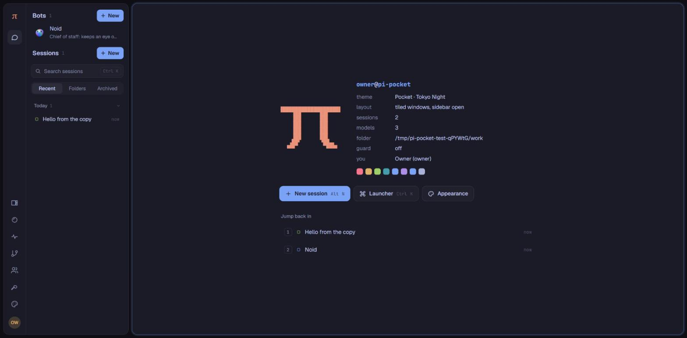
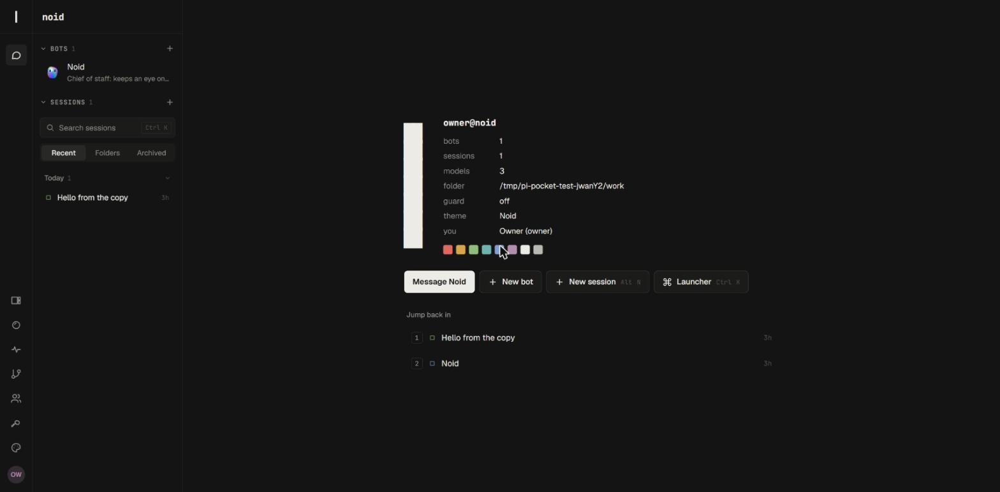
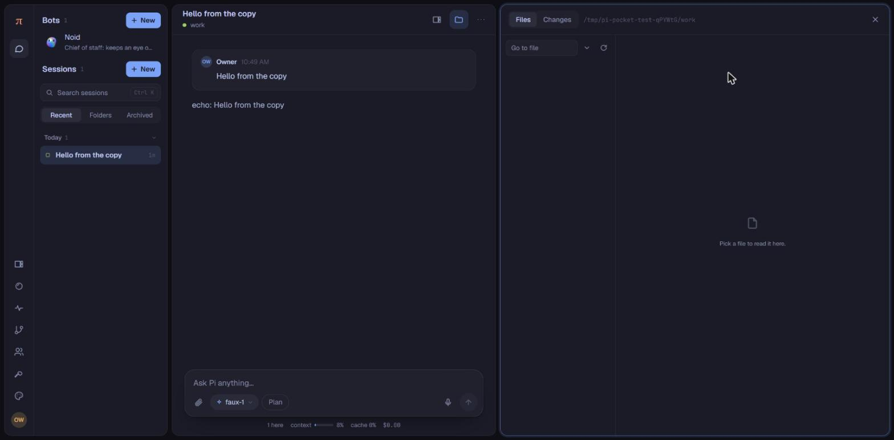
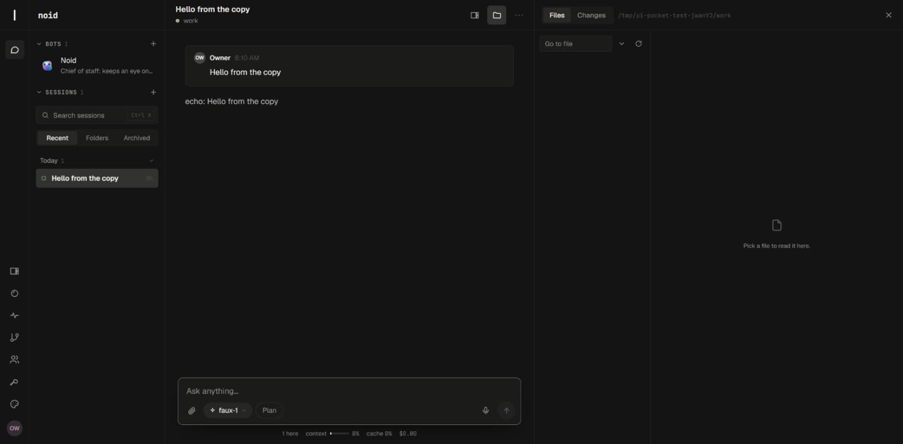
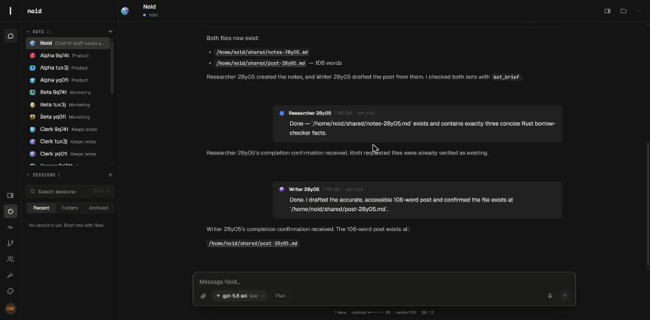
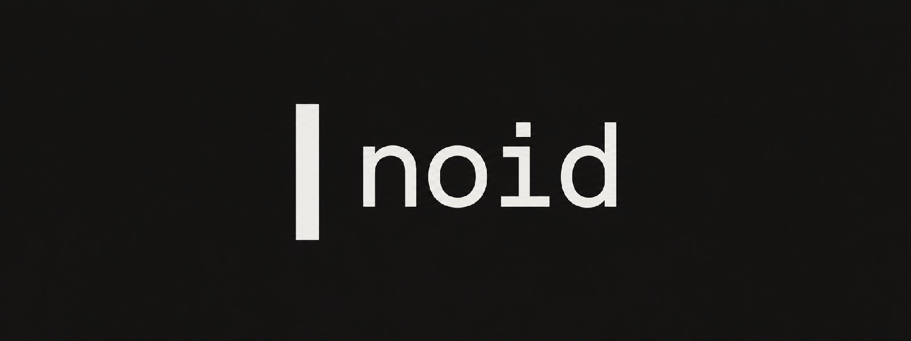
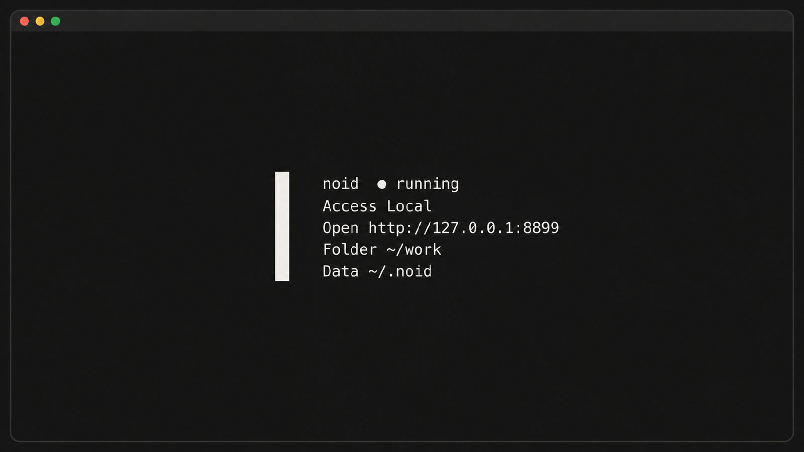
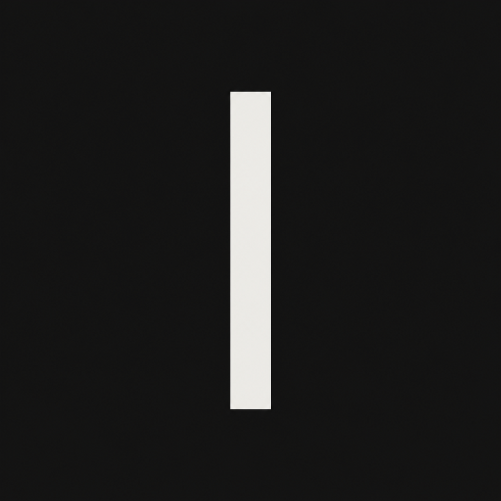

# noid's layout

noid started with pi-pocket's look: every pane a floating, rounded, glowing tile on a dark desktop, π everywhere, and
bright pill buttons. This branch moves it toward an editor's desktop, after pi-web-desktop: one window, panes that meet
at hairlines, a header line that runs across the whole width, quiet section heads, and edges you drag.

| Before                                | After                               |
| ------------------------------------- | ----------------------------------- |
|        |        |
|  |  |

## What changed

- **Panes, not tiles.** Wide screens show the sidebar, the conversation, and the side panel (browser or files) as panes
  of one window, split by 1px lines. The tiled look is still in Appearance, now with tighter corners (8px windows, 6px
  controls, down from 14 and 10).
- **One header line.** The rail's mark, the sidebar's head, the top bar, and every panel's bar share one height,
  `--head-h`, so their bottom lines meet across the window.
- **Sidebar sections.** `BOTS` and `SESSIONS` are small spaced capitals with their count. Each folds, and stays folded
  in this browser. A plus adds a bot or a session, where the blue "+ New" pills were.
- **One side panel, with tabs.** Files, Changes, and the Browser were separate panels with separate heads. They are now
  tabs on one panel head (`web/panel-tabs.js`), on the header line, with the folder and close at its end. Each tab's
  own tools sit under it, such as the browser's address bar. On a phone the head starts with a back button.
- **Many bots fit.** Bot rows are one line each (a smaller face, the name, the role quieter), and the bot list scrolls in
  its own section, with the open bot kept in sight. With 24 bots the sessions still show below them.
- **Conversations read as people and bots.** Your messages are quiet filled bubbles on the right, as wide as their
  words; the bots' replies run on the left. A message from another bot shows that bot's face and name and only its
  words: the safety preamble and `<bot-message>` tags the receiving bot reads stay out of sight. A failed request is a
  red line with a rule beside it, not a red box, so a run that retried a few times stays readable.

    

- **One assistant: Noid.** PiP, Pi Pocket's assistant over every session, did the job Noid does as overseer, from a
  chat card floating on the right. noid now ships PiP off (Extensions can turn it back on), so there is no second chat:
  you talk to Noid. Alt+A goes to Noid; the PiP panel, its bubble, its menu tile, and its launcher entry are gone with
  it. Memories stay in the session menu.
- **Edges to drag.** The sidebar, browser, and files edges, and the line between the bots and the sessions, use one
  splitter (`web/splitter.js`) instead of separate copies.
  Drag it, focus it and use the arrow keys (Shift for bigger steps, Home and End for the limits), or double-click it
  (or press Enter) to reset. The edge lights up while you drag or focus it.
- **Noid first.** The home screen counts bots and sessions apart. Its first button is **Message Noid**, then New bot,
  New session, and the launcher. The message box says "Message Noid…" in a bot's conversation, and "Ask anything…" in
  a plain session.
- **Colors.** **Noid** (dark) and **Noid Light** take the icon's ink, #222 on paper, as a graphite pair. The accent is
  the ink itself, so the only color on screen means something: status, diffs, code. Noid is the default, and every
  Omarchy palette is still in Appearance. Pi Pocket saved its defaults (the desktop's colors, tiles) as if chosen, so a
  browser drops those once for noid's; a palette its person picked stays.

## The logo

The icon is one upright bar. Pi draws its logo as pixel art, each pixel two full blocks (`██`) so it is square in a
monospace cell. noid's is drawn the same way: one pixel wide, seven tall, the icon's proportions.

```
██
██
██
██
██
██
██
```

- **Home screen:** beside the facts, fastfetch-style, as π was. It blinks three times as it appears, like a terminal
  cursor, then stays (not at all with reduced motion). A hairline text stroke closes the seams fonts leave between
  blocks.
- **Terminal:** the launcher's panel prints the same bar with its facts beside it.

    ```
      ██  noid  ● running
      ██
      ██  Access   Local
      ██  Open     http://127.0.0.1:8899
      ██  Folder   ~/work
      ██  Data     ~/.noid
      ██
    ```

- **Everywhere else** (the rail, boot screen, sign-in, empty conversation): `NoidMark`, the same bar in CSS, in the ink
  color.
- **App icons:** `web/icon.svg` and its PNGs are the bar on paper, inside a maskable icon's safe circle.
  `node scripts/icons.mjs` draws the PNGs from the same rectangles, so they are exact.

### Image generation, for comparison

Codex's image generator (given the original icon, and told to keep to it) drew the same ideas: the bar beside a
lowercase monospace wordmark, the bar beside a terminal's facts, and a dark icon. They agree with what is built here
(the rail's mark and the sidebar's "noid" are that lockup). Generated pixels carry a faint texture and colors that are
not exact, so the shipped mark, icons, and logo stay vector or computed; these are references.

| Lockup                    | Terminal                      | Dark icon                       |
| ------------------------- | ----------------------------- | ------------------------------- |
|  |  |  |

## Left as it was

- The rail stays as the activity bar, but holds only what has no other way in: home, the session list's fold, the
  subagents board, Appearance, and you (plus extensions' buttons). Running now, people and devices, and providers are in
  the launcher (Ctrl+K); peek tiles are in the top bar; Noid heads the bot list, so its rail button (still drawn with
  PiP's icon) went too.
- Pi Pocket's names remain inside, such as the `pocket.*` storage keys and the `pocket` theme id. Changing them would
  reset saved settings for no visible gain. Help text that means the engine ("needs a newer Pi Pocket") also stays.
- PiP's code stays, off: turning it on in Extensions brings back its panel and its GitHub repository watches.
