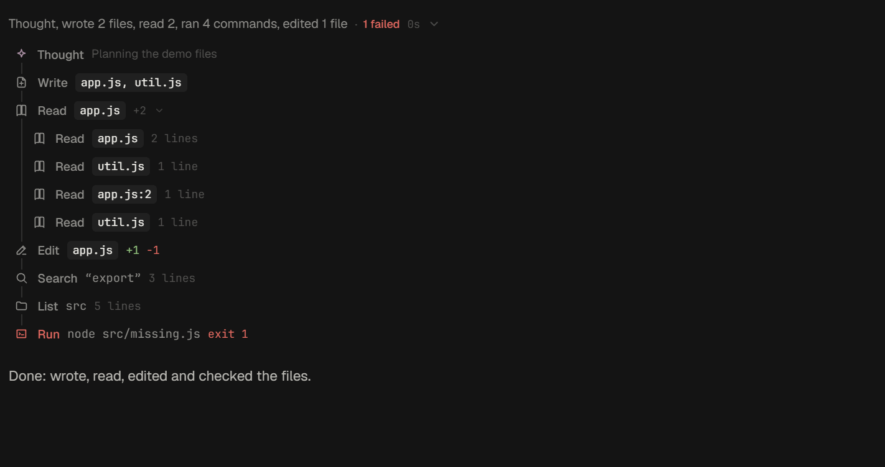

# noid's layout

noid started with pi-pocket's look: every pane a floating, rounded, glowing tile on a dark desktop, π everywhere, and
bright pill buttons. This branch moves it toward an editor's desktop, after pi-web-desktop: one window, panes that meet
at hairlines, a header line that runs across the whole width, quiet section heads, and edges you drag.

| Before                                | After                               |
| ------------------------------------- | ----------------------------------- |
|        |        |
|  |  |

## What changed

- **Panes, not tiles.** Wide screens show the sidebar, the conversation, and the side panel (browser or files) as panes
  of one window, split by 1px lines. The tiled look is still in Appearance, now with tighter corners (8px windows, 6px
  controls, down from 14 and 10).
- **One header line.** The rail's mark, the sidebar's head, the top bar, and every panel's bar share one height,
  `--head-h`, so their bottom lines meet across the window.
- **Bots and sessions are tabs.** The sidebar's head ends in two icon tabs, as Claude's chat and code ones: a robot for
  the bots and a terminal for the sessions. Only the chosen list shows, at the sidebar's full height, and the choice
  stays in this browser. Opening a bot or a session shows its tab, and a dot on the hidden tab says something there is
  working or needs you. Each list's head is `BOTS` or `SESSIONS` in small spaced capitals with its count, and a plus
  adds a bot or a session, where the blue "+ New" pills were.
- **One side panel, with tabs.** Files, Changes, and the Browser were separate panels with separate heads. They are now
  tabs on one panel head (`web/panel-tabs.js`), on the header line, with the folder and close at its end. Each tab's
  own tools sit under it, such as the browser's address bar. On a phone the head starts with a back button.
- **Many bots fit.** Bot rows are compact (the face, the name, what the bot last said quieter), and the Bots tab
  scrolls, with the open bot kept in sight.
- **Conversations read as people and bots.** Your messages are quiet filled bubbles on the right, as wide as their
  words; the bots' replies run on the left. A message from another bot shows that bot's face and name and only its
  words: the safety preamble and `<bot-message>` tags the receiving bot reads stay out of sight. A failed request is a
  red line with a rule beside it, not a red box, so a run that retried a few times stays readable.

    

- **One assistant: Noid.** Pi Pocket's assistant over every session did the overseer's job from a chat card floating
  on the right. Noid does it now, in its own conversation: it has the session tools (list, read, start, message,
  follow, stop, archive, schedule, deny waiting calls, watch repositories and PRs) beside its bots and bash. The
  assistant's panel, bubble, menu tile, and launcher entry are gone; Alt+A, "Message Noid" in the launcher, and `/noid`
  go to Noid. Its empty conversation starts with a few questions ("What needs me?", "What happened today?"), as a plain
  list.
  Since its tools act as you, Noid is yours alone: a guest you invite cannot see it.
- **Every bot has the session tools too.** Any bot can list, read, start, message, follow, stop, and schedule sessions
  when its job needs work in a folder on your machine. They act as you, so every bot is yours alone. Bots are not
  sessions to these tools: a bot reaches another with `bot_message`. Making, changing, and archiving bots stays
  Noid's.
- **Edges to drag.** The sidebar, browser, and files edges, and the line between the bots and the sessions, use one
  splitter (`web/splitter.js`) instead of separate copies.
  Drag it, focus it and use the arrow keys (Shift for bigger steps, Home and End for the limits), or double-click it
  (or press Enter) to reset. The edge lights up while you drag or focus it.
- **Bots as Grok lists them.** Noid on its own at the top, a big face over its name; each other bot a 44px face, its
  name, and what it last said under it (what it is doing instead, while it works, waits, or failed). The server sends
  each bot's last words with the session list (`said`). The top bar's face is as big as the list's, with room to its
  left.
- **Noid first.** The home screen counts bots and sessions apart. Its first button is **Message Noid**, then New bot,
  New session, and the launcher. The message box says "Message Noid…" in a bot's conversation, and "Ask anything…" in
  a plain session.
- **Colors.** **Noid** (dark) and **Noid Light** take the icon's ink, #222 on paper, as a graphite pair. The accent is
  the ink itself, so the only color on screen means something: status, diffs, code. Noid is the default, and every
  Omarchy palette is still in Appearance. Pi Pocket saved its defaults (the desktop's colors, tiles) as if chosen, so a
  browser drops those once for noid's; a palette its person picked stays.

## What Pi did: tool calls

After pi-web-desktop's process view. What Pi did between its words is one quiet line, not a card: what it did in words
("Thought, wrote 2 files, read 2, ran 4 commands"), failures in red, how long, and a chevron. Opened, it is a timeline:

- **A line per step, an icon for its kind.** Read, edit, write, search, list, run, message a bot, check on one, and so on,
  each with its own icon on the rule. A call still running shows a spinner there; one that failed turns red. There is
  no check mark for a call that went well: most do.
- **A verb and what it acts on**, not the tool's name and its arguments as JSON (`web/steps.js`): "Read app.js", "Search
  “export”", "Message Researcher", "Run node src/missing.js". A file shows as a small tag by its name (its path on
  hover). Shell commands read by what they do: `cat`, `sed -n` read; `rg` and `grep` search; `ls` lists; `curl` fetches;
  anything else runs. More words follow, dimmer: what a message said, a thought's first line.
- **Calls of a kind in a row share a line**: "Write app.js, util.js", "Read app.js +2". It opens to each call's own
  line, and each of those to its input and output. Calls that failed, wait for approval, made something (images, an
  artifact), or are still running keep lines of their own.
- **How long each call took**, from when the model finished the answer that asked for it (the server now sends that
  time, `endedAt`) to its result, from a second on. Before, the only time to hand was when the answer began, which
  counts the model's writing too.



## The logo

The icon is one upright bar. Pi draws its logo as pixel art, each pixel two full blocks (`██`) so it is square in a
monospace cell. noid's is drawn the same way: one pixel wide, seven tall, the icon's proportions.

```
██
██
██
██
██
██
██
```

- **Home screen:** beside the facts, fastfetch-style, as π was. It blinks three times as it appears, like a terminal
  cursor, then stays (not at all with reduced motion). A hairline text stroke closes the seams fonts leave between
  blocks.
- **Terminal:** the launcher's panel prints the same bar with its facts beside it.

    ```
      ██  noid  ● running
      ██
      ██  Access   Local
      ██  Open     http://127.0.0.1:8899
      ██  Folder   ~/work
      ██  Data     ~/.noid
      ██
    ```

- **Everywhere else** (the rail, boot screen, sign-in, empty conversation): `NoidMark`, the same bar in CSS, in the ink
  color.
- **App icons:** `web/icon.svg` and its PNGs are the bar on paper, inside a maskable icon's safe circle.
  `node scripts/icons.mjs` draws the PNGs from the same rectangles, so they are exact.

### Image generation, for comparison

Codex's image generator (given the original icon, and told to keep to it) drew the same ideas: the bar beside a
lowercase monospace wordmark, the bar beside a terminal's facts, and a dark icon. They agree with what is built here
(the rail's mark and the sidebar's "noid" are that lockup). Generated pixels carry a faint texture and colors that are
not exact, so the shipped mark, icons, and logo stay vector or computed; these are references.

| Lockup                    | Terminal                      | Dark icon                       |
| ------------------------- | ----------------------------- | ------------------------------- |
|  |  |  |

## Left as it was

- The rail stays as the activity bar, but holds only what has no other way in: home, the session list's fold, the
  subagents board, Appearance, and you (plus extensions' buttons). Running now, people and devices, and providers are in
  the launcher (Ctrl+K); peek tiles are in the top bar; Noid heads the bot list, so its rail button went too.
- Pi Pocket's names remain inside, such as the `pocket.*` storage keys and the `pocket` theme id. Changing them would
  reset saved settings for no visible gain. Help text that means the engine ("needs a newer Pi Pocket") also stays.
- The assistant's server side stays, as Noid's session tools (Extensions › Noid's session tools). Pi Pocket's separate
  assistant conversation, made when there was no main bot, is gone: noid always has Noid.
